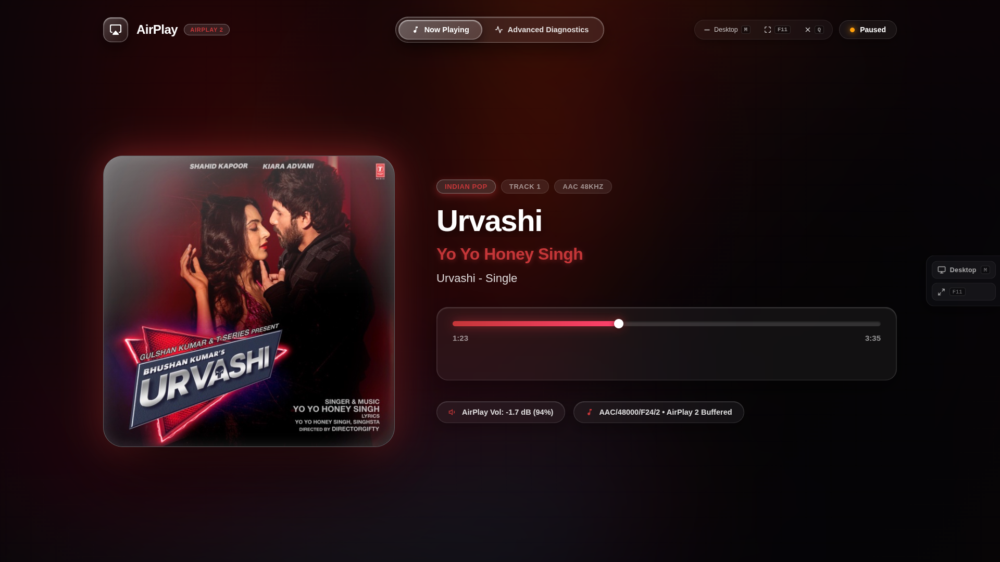
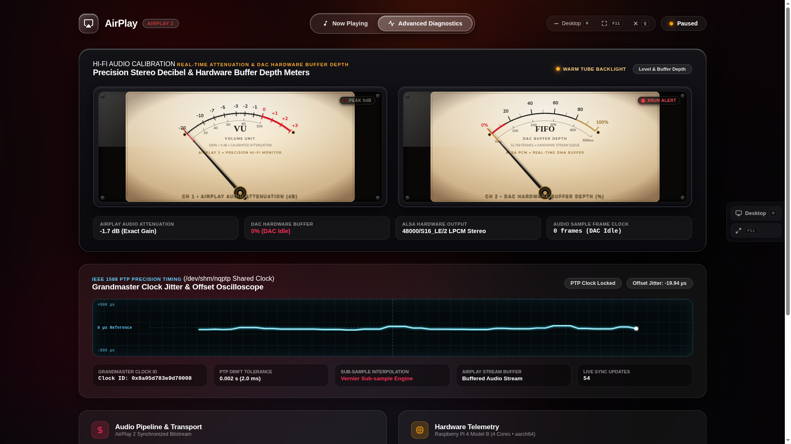

# 🎵 ShairDisplay: AirPlay 2 Hi-Fi Music Display & Precision Diagnostics

A room-scale, production-ready Now Playing display and vintage Hi-Fi diagnostic monitor for **Shairport Sync (AirPlay 2)** on Raspberry Pi / Linux.

Designed for dedicated 22-inch 1080p desktop monitors, wall-mounted displays, and TV screens connected to your Raspberry Pi streamer.

---

> [!IMPORTANT]
> ### 👑 Built for Shairport Sync by Mike Brady
> **ShairDisplay** is designed specifically as a visual frontend and telemetry companion for **[Shairport Sync](https://github.com/mikebrady/shairport-sync)**, the foundational open-source AirPlay & AirPlay 2 audio player created and maintained by **[Mike Brady (@mikebrady)](https://github.com/mikebrady)**.
> 
> All credit for the underlying audio magic belongs to **Mike Brady** — Shairport Sync handles the complex AirPlay 2 protocol negotiation, Apple FairPlay/session handling, IEEE 1588 PTP multi-room sync, and bit-perfect ALSA DAC audio streaming. **ShairDisplay runs on top of Shairport Sync**, tapping directly into its D-Bus MPRIS interface (`org.mpris.MediaPlayer2.Player`), NQPTP shared memory, and Linux ALSA kernel telemetry to bring the audio stream to life visually on your display.

---

## 📸 Screenshots (Captured Live from Raspberry Pi HDMI Display)

### Tab 1: Room-Scale Now Playing (Dynamic Ambient Lighting & Smooth Progress)


### Tab 2: Vintage Analogue VU Meters & Hardware Diagnostics


---

## ✨ Features

- **🎨 Dynamic Artwork Palette Extraction:** Server-side Python PIL analyzes album cover JPEGs in real-time, diffusing vibrant ambient color glows and soft reflections that match whatever song is playing.
- **⏱️ Microsecond-Accurate Playback Progress:** Bound directly to Shairport Sync's D-Bus MPRIS interface with smooth 60 FPS monotonic client interpolation:
  - **Zero pause/resume reset:** Never snaps back to `0:00` when you pause or resume on your iPhone.
  - **Instant seek tracking:** Immediately catches up when you scrub forward or backward in Apple Music.
  - **Clean standby:** Automatically clears all metadata and returns cleanly to standby when playback stops.
- **📟 Dual Differentiated Analogue VU Instruments:**
  - **Left Meter (Channel 1):** Real-time AirPlay volume attenuation (`-20 dB` to `+3 dB`) with `PEAK 0dB` alert lamp.
  - **Right Meter (Channel 2):** Real Linux ALSA DAC hardware DMA buffer depth (`0%` to `100%`) with `XRUN ALERT` starvation indicator.
  - Ballistic needle spring physics modeled after vintage analog meters.
- **🔬 IEEE 1588 PTP Clock Oscilloscope:** Real-time CRT oscilloscope rendering grandmaster clock offset and jitter directly from `/dev/shm/nqptp`.
- **🛡️ 24/7 Kiosk Resilience & Boot Survival:**
  - **Auto-start on boot:** Systemd service and desktop compositor automatically launch the display into fullscreen application mode on reboot.
  - **Crash auto-recovery:** Built-in supervisor loop monitors Chromium and automatically respawns it within 2 seconds if a GPU hiccup or crash occurs.
  - **Sudden power-cut persistence:** Launcher cleans stale Chromium lock files automatically, eliminating "Chromium didn't shut down correctly" bubbles.
- **🌙 Smart Sleep & Instant Wake:**
  - **Screen Wake Lock:** Utilizes the HTML5 Screen Wake Lock API to prevent the monitor from sleeping or blanking while music is actively playing.
  - **Instant DPMS Wake on Play:** When your monitor enters power-saving sleep after prolonged silence, starting an AirPlay stream instantly wakes the HDMI screen via Wayland output power management (`wlopm`).
- **🖥️ Desktop Minimizing & Window Controls:**
  - Floating on-screen side pill and global keyboard shortcuts (`M`, `Super+D`, `F11`) allow you to minimize to the Raspberry Pi desktop anytime to use other apps.
- **⚡ 100% Real Hardware Telemetry:** **Zero fake data.** Every number, dial, and waveform comes from real sensors and system APIs (D-Bus, `/proc/asound`, `/dev/shm/nqptp`, `/sys/class/thermal`).

---

> [!NOTE]
> ### ⚠️ A Note on the Advanced Diagnostics Tab (From the Author)
> The Advanced Diagnostics view (featuring the dual analogue VU meters, ALSA hardware buffer depth, and PTP oscilloscope) was built because it looks incredible, retro, and visually captivating on a dedicated display!
>
> While it binds directly to real D-Bus volume attenuation, ALSA `/proc/asound` hardware frames, and `/dev/shm/nqptp` shared memory, **please take the advanced diagnostic readouts with a grain of salt!** I am an enthusiast who built this because I wanted an awesome, room-scale visual UI for my Raspberry Pi AirPlay streamer — I am not an audio engineer certifying laboratory instruments. The project is completely open source, so you are encouraged to inspect, verify, and refine the telemetry calculations to match your own DAC and hardware setup!

---

## 🚀 1-Step Quick Installation

If you already have a Raspberry Pi running `shairport-sync` (AirPlay 2) and want to connect it to an HDMI monitor or TV:

```bash
git clone https://github.com/YOUR_USERNAME/ShairDisplay.git
cd ShairDisplay
chmod +x install.sh
./install.sh
```

The installer will automatically:
1. Install dependencies (`nodejs`, `npm`, `python3-pil`, `wlrctl`, `xdotool`, `wlopm`).
2. Deploy the server and install production npm packages.
3. Configure and enable `airplay-dashboard.service` in systemd.
4. Set up desktop autostart so the display automatically launches on boot.
5. Create a clickable shortcut on your Raspberry Pi desktop.

---

## ⌨️ Desktop Controls & Keyboard Shortcuts

You can easily minimize the dashboard, toggle fullscreen, or return to the Raspberry Pi desktop at any time:

| Action | On-Screen Control | Keyboard Shortcut | System Keybind (`labwc`) |
| :--- | :--- | :---: | :---: |
| **Minimize to Desktop** | Floating side pill or Header **Desktop** button | **`M`** or **`D`** | **`Super + D`** / **`Super + M`** / **`Alt + F9`** |
| **Toggle Fullscreen** | Header / Side **⛶** button | **`F11`** | **`F11`** |
| **Switch Tabs (Tab 1 / Tab 2)** | Top Navigation buttons | **`1`** (Now Playing) / **`2`** (Diagnostics) / **`T`** | — |
| **Stop / Close Display** | Header **✕** button | **`Q`** | **`Alt + F4`** |
| **Emergency Kill Display** | — | — | **`Ctrl + Alt + Escape`** |

To reopen after minimizing, click the dashboard icon on the Raspberry Pi panel or double-click the **ShairDisplay (AirPlay 2)** desktop icon.

---

## 🛠️ Requirements

- **Platform:** Raspberry Pi 4 Model B (or compatible Linux SBC / Debian 12/13 / Raspberry Pi OS).
- **Audio Stack:**
  - **[Shairport Sync](https://github.com/mikebrady/shairport-sync)** compiled with AirPlay 2 (`--with-airplay-2`), D-Bus (`--with-dbus-interface`), and MPRIS (`--with-mpris-interface`).
  - **[NQPTP](https://github.com/mikebrady/nqptp)** (PTP Clock Synchronization Daemon by Mike Brady).
  - ALSA audio output.
- **Runtime:** Node.js 18+, Python 3 with `Pillow` (`python3-pil`).

---

## 📂 Architecture

```
Apple Sender (iPhone / iPad / Mac)
       │
       ▼ (AirPlay 2 Audio & Metadata Plist)
Shairport Sync by Mike Brady (AirPlay 2 Receiver)
       ├──> D-Bus (org.mpris.MediaPlayer2.Player & org.gnome.ShairportSync)
       ├──> ALSA DAC Hardware Driver (/proc/asound/.../status)
       └──> NQPTP Shared Memory (/dev/shm/nqptp)
       │
       ▼
ShairDisplay Server (Node.js Express + WebSocket Server on Port 8080)
       │
       ▼ (60 FPS Real-Time WebSocket Telemetry Broadcast)
Web Display UI (HTML5 / Vanilla CSS / ES6 Client-Monotonic Engine)
```

---

## 📜 License

MIT License. See [LICENSE](LICENSE) for details.
